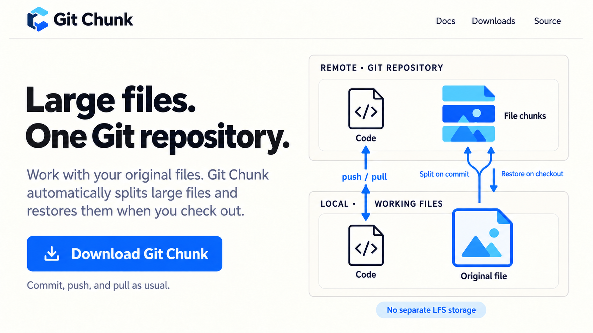

<p align="center">
  
</p>
<h1 align="center">Git Chunk</h1>
<p align="center"><strong>Large files. One Git repository.</strong></p>
<p align="center">
  <a href="https://github.com/MDJ0126/GitChunk/releases/latest">Download</a> &middot;
  <a href="https://mdj0126.github.io/GitChunk/">Website</a> &middot;
  <a href="https://mdj0126.github.io/GitChunk/guide.html">Guide</a> &middot;
  <a href="README.md">English</a> &middot;
  <a href="README.ko.md">한국어</a>
</p>

---

**Keep large files in Git and work as usual.**

Install Git Chunk and set it up once for your project. Then **edit your original files and commit, push, and pull as usual**. You do not need to split files or put them back together yourself. No .NET SDK is needed.

<p align="center">
  
</p>

## What changes in everyday use?

1. Edit images, videos, game assets, and other files in your usual programs.
2. Commit and push your changes as usual. Git Chunk automatically splits large files for storage.
3. Pull changes on another computer or switch versions, and the original files are restored automatically.

**You do not need to open the Git Chunk app or run an extra command each time.** Setup is needed when first applying it to a project and after cloning on a new computer. Each collaborator also needs to install Git Chunk and set it up for the project.

## How is it similar to Git LFS?

Both help manage large files while **you keep working with the originals as usual**. Git Chunk's difference is that it splits large files and **keeps them in the same Git repository as your code**.

| Everyday question | Git LFS | Git Chunk |
| --- | --- | --- |
| Do my working files change? | You work with the originals | You work with the originals |
| Is extra work needed each time? | After setup, processing happens automatically during normal Git use | After setup, processing happens automatically during normal Git use |
| Where are large files kept? | Separate LFS storage | **The same Git repository as your code** |
| Do I need to split files myself? | No | No; **large files are split and restored automatically** |
| Do I need a separate file storage service? | LFS support from your Git host or a separate LFS service | **Uses your existing Git repository; no separate LFS service needed** |
| Which storage allowance is used? | LFS storage | **Ordinary Git repository storage** |

Splitting files does not reduce their total size. Your Git host's storage limits still apply.

## Install and set up your project

### 1. Install Git Chunk

**Windows:** [Download and run the installer](https://github.com/MDJ0126/GitChunk/releases/latest). If you use Scoop, you can also install with:

```powershell
scoop bucket add gitchunk https://github.com/MDJ0126/GitChunk.git
scoop install gitchunk/git-chunk
```

**Mac:** Install with Homebrew:

```bash
brew tap MDJ0126/gitchunk https://github.com/MDJ0126/GitChunk
brew install --cask MDJ0126/gitchunk/git-chunk
```

### 2. Apply it to your project

Select the project folder in the Git Chunk app and click **Install Git Chunk**. Or run this command in the top-level folder of your project's Git repository:

```bash
git chunk install
```

If the project already has files tracked by Git, run these commands once to apply the new storage method and commit the configuration. For an existing Git LFS project, follow the conversion steps below instead.

```bash
git add -u
git add --renormalize .
git add .gitattributes .gitignore .gitchunk
git commit -m "Configure Git Chunk"
```

**You can now use Git as usual.** After cloning the project on a new computer, run `git chunk install` once there too.

## Already using Git LFS?

You can convert your current files to Git Chunk. First commit your changes or temporarily save them with stash. Git LFS must be installed, and you need access to the remote repository in case originals need to be downloaded.

Run these commands in the project folder. `git diff --cached` lets you review the changes before committing.

```bash
git chunk install
git diff --cached
git commit -m "Convert current LFS files to Git Chunk"
git push
```

Conversion automatically prepares the changes for a commit. You commit and push them yourself. **Past LFS data stays in place; existing LFS storage is not automatically freed.** See the [conversion guide](https://mdj0126.github.io/GitChunk/guide.html#convert-an-existing-git-lfs-project) for details.

## Updates and extra settings

Update from your project folder with:

```bash
git chunk update
```

Older versions without this command need a one-time upgrade through the installer or package manager.

By default, files **over 50 MiB** are split into chunks of up to **49 MiB**. Use the app's exclusion list or `.chunkignore` for files you want to keep whole. Do not delete the automatically created `.gitchunk/objects` folder: it is needed to restore files.

[Detailed usage and uninstall](https://mdj0126.github.io/GitChunk/guide.html) · [Distribution](Packaging/README.md) · [Technical notes](INSTRUCTIONS.md)

Comparison references: [Git LFS documentation](https://github.com/git-lfs/git-lfs/blob/main/docs/man/git-lfs.adoc), [GitHub LFS storage and billing](https://docs.github.com/en/billing/concepts/product-billing/git-lfs).
