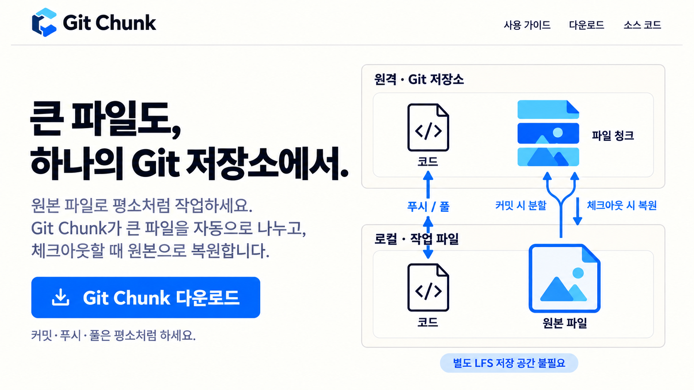

<p align="center">
  
</p>
<h1 align="center">Git Chunk</h1>
<p align="center"><strong>큰 파일도, 하나의 Git 저장소에서.</strong></p>
<p align="center">
  <a href="https://github.com/MDJ0126/GitChunk/releases/latest/download/GitChunk-Setup-win-x64.exe">다운로드</a> &middot;
  <a href="https://mdj0126.github.io/GitChunk/"><strong>문서 사이트</strong></a> &middot;
  <a href="https://mdj0126.github.io/GitChunk/guide.ko.html">사용 가이드</a> &middot;
  <a href="README.md">English</a> &middot;
  <a href="README.ko.md">한국어</a>
</p>

---

**큰 파일도 Git으로 관리하고, 작업은 평소처럼 하세요.**

Git Chunk를 설치하고 프로젝트에 한 번 적용하면, 이후에는 **원본 파일을 편집하고 평소처럼 커밋·푸시·풀**하시면 됩니다. 파일을 직접 나누거나 다시 합칠 필요가 없습니다. .NET SDK도 필요 없습니다.

<p align="center">
  
</p>

## 설치 후에는 어떻게 사용하나요?

1. 이미지, 영상, 게임 리소스 등을 기존 프로그램에서 그대로 편집합니다.
2. 평소처럼 변경한 파일을 커밋하고 푸시합니다. 큰 파일은 Git Chunk가 자동으로 나누어 저장합니다.
3. 다른 PC에서 풀하거나 다른 버전으로 이동하면 원본 파일로 자동 복원됩니다.

**매번 Git Chunk 앱을 열거나 별도 명령을 실행할 필요는 없습니다.** 처음 프로젝트에 적용할 때와 새 PC에서 프로젝트를 내려받았을 때만 설정이 필요합니다. 함께 작업하는 분들도 각자 설치하고 프로젝트에 적용해 주세요.

## Git LFS와 무엇이 비슷하고 다른가요?

둘 다 큰 파일을 관리하면서 **사용자는 원본 파일로 평소처럼 작업**할 수 있게 해줍니다. Git Chunk는 큰 파일을 나누어 **코드와 같은 Git 저장소에 함께 보관**한다는 점이 다릅니다.

| 사용자가 궁금한 점 | Git LFS | Git Chunk |
| --- | --- | --- |
| 작업할 때 파일이 달라지나요? | 원본 파일 그대로 사용 | 원본 파일 그대로 사용 |
| 매번 별도 작업이 필요한가요? | 초기 설정 후 일반 Git 작업에 맞춰 자동 처리 | 초기 설정 후 일반 Git 작업에 맞춰 자동 처리 |
| 큰 파일은 어디에 보관되나요? | 별도 LFS 저장 공간 | **코드와 같은 Git 저장소** |
| 파일을 직접 나눠야 하나요? | 필요 없음 | 필요 없음, **큰 파일을 자동으로 나누고 복원** |
| 별도 파일 저장 서비스가 필요한가요? | Git 호스팅 서비스의 LFS 지원 또는 별도 LFS 서비스 필요 | **기존 Git 저장소 사용, 별도 LFS 서비스 불필요** |
| 저장 용량은 어디에 포함되나요? | LFS 저장 용량 | **일반 Git 저장소 용량** |

파일을 나누어도 전체 용량이 줄어드는 것은 아닙니다. Git 호스팅 서비스의 용량 제한은 그대로 적용됩니다.

## 설치하고 프로젝트에 적용하기

### 1. Git Chunk 설치

**Windows:** [설치 파일을 다운로드](https://github.com/MDJ0126/GitChunk/releases/latest)해 실행하세요. Scoop을 사용하신다면 다음 명령으로 설치할 수도 있습니다.

```powershell
scoop bucket add gitchunk https://github.com/MDJ0126/GitChunk.git
scoop install gitchunk/git-chunk
```

**Mac:** Homebrew로 설치하세요.

```bash
brew tap MDJ0126/gitchunk https://github.com/MDJ0126/GitChunk
brew install --cask MDJ0126/gitchunk/git-chunk
```

### 2. 사용할 프로젝트에 적용

Git Chunk 앱에서 프로젝트 폴더를 선택하고 **Install Git Chunk**를 누르세요. 또는 프로젝트의 Git 저장소 최상위 폴더에서 다음 명령을 실행하세요.

```bash
git chunk install
```

기존에 Git으로 관리하던 파일이 있다면, 처음 한 번 아래 명령으로 새 저장 방식을 적용하고 설정을 커밋하세요. 기존 Git LFS 프로젝트라면 아래 전환 안내를 따라 주세요.

```bash
git add -u
git add --renormalize .
git add .gitattributes .gitignore .gitchunk
git commit -m "Configure Git Chunk"
```

**이제 평소처럼 Git을 사용하시면 됩니다.** 새 PC에서 프로젝트를 clone한 뒤에도 `git chunk install`을 한 번 실행하세요.

## 이미 Git LFS를 사용하고 있다면

현재 파일을 Git Chunk 방식으로 전환할 수 있습니다. 먼저 작업 중인 변경 사항을 커밋하거나 stash로 임시 보관해 주세요. 원본 파일을 내려받아야 할 수 있으므로 Git LFS가 설치되어 있고 원격 저장소에 접근할 수 있어야 합니다.

프로젝트 폴더에서 아래 명령을 실행하세요. `git diff --cached`는 커밋할 변경 내용을 확인하는 단계입니다.

```bash
git chunk install
git diff --cached
git commit -m "Convert current LFS files to Git Chunk"
git push
```

전환 결과는 커밋할 준비까지 자동으로 처리됩니다. 커밋과 푸시는 직접 하셔야 합니다. **과거 LFS 데이터는 그대로 남으며, 기존 LFS 저장 용량이 자동으로 비워지지는 않습니다.** 자세한 내용은 [전환 안내](https://mdj0126.github.io/GitChunk/guide.ko.html#기존-git-lfs-프로젝트-전환)를 참고하세요.

## 업데이트와 추가 설정

프로젝트 폴더에서 다음 명령으로 업데이트하세요.

```bash
git chunk update
```

이 명령이 없는 구버전은 설치 파일이나 패키지 관리자로 먼저 업그레이드하세요.

기본적으로 **50 MiB 초과** 파일을 최대 **49 MiB**씩 나누어 저장합니다. 나누고 싶지 않은 파일은 앱의 제외 목록이나 `.chunkignore`에 지정할 수 있습니다. 자동으로 만들어지는 `.gitchunk/objects` 폴더는 파일 복원에 필요하므로 삭제하지 마세요.

[상세 사용법 및 제거 방법](https://mdj0126.github.io/GitChunk/guide.ko.html) · [배포 정보](Packaging/README.md) · [기술 설명](INSTRUCTIONS.md)

비교 참고: [Git LFS 공식 문서](https://github.com/git-lfs/git-lfs/blob/main/docs/man/git-lfs.adoc), [GitHub LFS 용량·요금 안내](https://docs.github.com/en/billing/concepts/product-billing/git-lfs).
