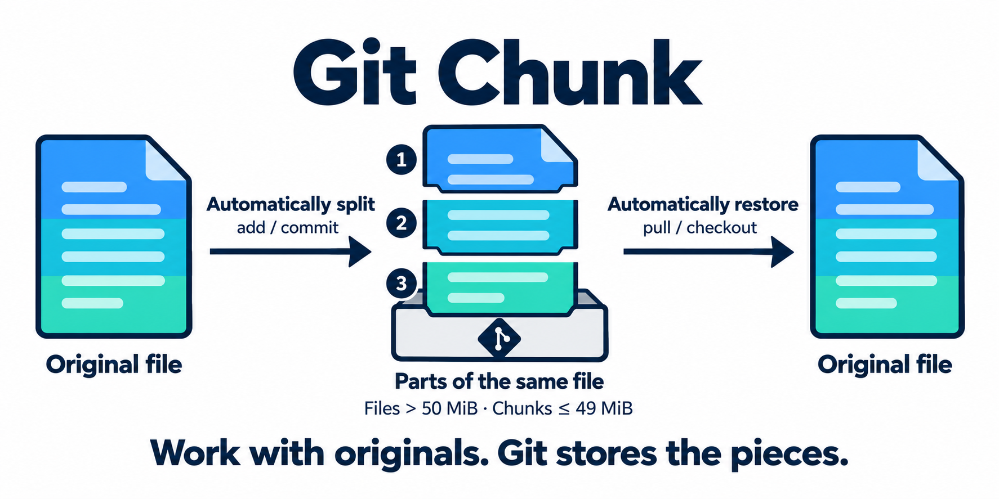

# Git Chunk

[한국어](README.ko.md)

**Manage large assets without Git LFS.** Files over **50 MiB** are stored in chunks of up to **49 MiB**, while you work with full originals locally. No .NET SDK needed.



## Compared with Git LFS

| Item | Git Chunk | Git LFS |
| --- | --- | --- |
| Storage | A pointer at the original path plus chunks in `.gitchunk/objects`, all stored in Git | A pointer in Git; original contents stored on an LFS server |
| Large-file handling | Automatically splits files over 50 MiB into chunks of up to 49 MiB; `.chunkignore` excludes matching files | Tracks file patterns configured with `git lfs track` |
| Remote requirements | Uses the existing Git remote; no LFS endpoint required | Requires an LFS endpoint, provided by the host or configured separately |
| Local setup | Install Git Chunk, then run `git chunk install` in each repository, including after cloning | Install Git LFS, run `git lfs install`, and configure tracking patterns |
| Everyday workflow | Normal Git commands; filters and hooks store chunks and restore originals | Normal Git commands; Git LFS transfers originals separately |
| Storage and bandwidth | Chunk history contributes to Git repository size; the Git host's limits still apply | LFS storage and bandwidth follow the provider's policies; GitHub meters them separately |

**Splitting does not reduce total asset size or remove repository limits.** Asset revisions remain in Git history and can increase clone size. Git Chunk does not use LFS storage for converted files, but converting an existing project does not delete its past LFS objects.

References: [Git LFS documentation](https://github.com/git-lfs/git-lfs/blob/main/docs/man/git-lfs.adoc), [LFS server configuration](https://github.com/git-lfs/git-lfs/blob/main/docs/api/server-discovery.md), [GitHub LFS billing](https://docs.github.com/en/billing/concepts/product-billing/git-lfs).

## Install

**Windows:** [Download the installer](https://github.com/MDJ0126/GitChunk/releases/latest), or use Scoop:

```powershell
scoop bucket add gitchunk https://github.com/MDJ0126/GitChunk.git
scoop install gitchunk/git-chunk
```

**Mac:** Use Homebrew:

```bash
brew tap MDJ0126/gitchunk https://github.com/MDJ0126/GitChunk
brew install --cask MDJ0126/gitchunk/git-chunk
```

## Get started

Run once in your project's Git repository root, including after cloning on a new PC:

```bash
git chunk install
```

For existing tracked files, apply and commit the configuration:

```bash
git add -u
git add --renormalize .
git add .gitattributes .gitignore .gitchunk
git commit -m "Configure Git Chunk"
```

Then use **add, commit, push, pull and checkout** as usual. You can also select a project in the app and click **Install Git Chunk**.

Add patterns such as `Build/**` to `.chunkignore` to store matching files whole. Do not delete `.gitchunk/objects`.

## Convert a Git LFS project

Requires **v1.1.0 or later**. Commit or stash tracked changes first. Git LFS and remote access are required to download missing originals.

```bash
git chunk install
git diff --cached
git commit -m "Convert current LFS files to Git Chunk"
git push
```

Installation converts current LFS files and stages the result; it does not commit or push automatically. **Past LFS history and server storage are preserved.** See the [detailed guide](docs/guide.md#convert-an-existing-git-lfs-project) for conversion limits and storage cleanup.

## Update

```bash
git chunk update
```

Run in the repository root. Older versions without this command need a one-time upgrade through the installer or package manager.

[Detailed guide and uninstall](docs/guide.md) · [Distribution](Packaging/README.md) · [Technical notes](INSTRUCTIONS.md)
